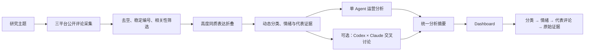

# Game Ops Insight Lab

> 从公开玩家评论中提取可验证问题，并形成能够回溯到真实证据的游戏运营判断。

Game Ops Insight Lab 是一套面向游戏运营事件研究的本地工作台。它把抖音、Bilibili、小红书的公开评论采集，评论清洗与语义折叠，玩家情感与运营风险分析，单/双 Agent 复核，以及可交互 Dashboard 串成一条完整证据链。

本项目不把有限社媒样本包装成全体玩家民调，也不根据评论推断真实流水、留存或退游规模。

> Dashboard 与双 Agent 运行截图将在正式发布前补充到 `docs/assets/`。

## 系统做什么



核心能力：

- 三平台公开内容采集，保留固定内容与关键词搜索的选择原因；
- 先做确定性清理，再由模型判断相关性与高度同质表达；
- 使用 `support_count` 保留折叠前的表达量，不把语义去重误写成删重；
- 分类、情绪、代表评论和完整评论能够逐层回溯；
- 普通事件默认单 Agent，复杂争议可选择对等双 Agent 讨论；
- 最终报告明确区分已核实事实、样本反馈、分析判断和待验证风险。

## 项目结构

```text
.agents/skills/game-ops-insight-suite/  GitHub版一体化入口 Skill
adapter/                               三平台本地 FastAPI 适配层
comment-cleaning/                      清洗与折叠提示、数据约定
dual-agent/                            Codex × Claude 会话主持程序
insight-dashboard/                     FastAPI + React 调研看板
scripts/                               采集服务与确定性处理脚本
schemas/                               采集任务 Schema
source/                                MediaCrawler 固定版本子模块
```

## 快速开始（Windows）

环境要求：Python 3.11+、Node.js 20.19+、Git、Chrome，以及已安装并登录的 Codex CLI 与 Claude CLI（仅双 Agent 模式需要）。

```powershell
git clone --recurse-submodules https://github.com/x736260980-ui/game-ops-insight-lab.git
cd game-ops-insight-lab
powershell -ExecutionPolicy Bypass -File .\setup.ps1
```

启动 Dashboard：

```powershell
.\insight-dashboard\start-dashboard.cmd
```

启动采集服务：

```powershell
.\scripts\run_douyin_api.ps1
.\scripts\run_bilibili_api.ps1
.\scripts\run_xiaohongshu_api.ps1
```

双 Agent 只在需要时启动：

```powershell
.\dual-agent\start_dual_agent.cmd
```

在 Codex 中可以直接调用：

```text
使用 $game-ops-insight-suite，研究指定游戏事件。默认先走单 Agent；只有我明确确认时才启动双 Agent。
```

## 输出约定

每次调查使用独立目录。常用稳定产物包括：

```text
analysis-input.json
semantic-analysis.json
classification-plan.json
dashboard.json
dual-agent/
├─ 01-codex-initial.md
├─ 02-claude-initial.md
├─ 03-transcript.md
├─ 04-disputes.json
├─ 05-final-analysis.md
└─ 05-final-summary.json
```

`05-final-summary.json` 是分析层到 Dashboard 的稳定协议。风险使用 `0—1` 分数，并映射为 `low / middle / high`；置信度单独表达证据强弱。

## 案例说明

案例将在确认具体公开范围后单独整理。本仓库当前不包含本机历史运行目录、原始平台导出或评论样本。

## 项目边界

- 公开评论是有偏差的玩家信号，不代表全体玩家。
- 评论中的官方动机、销量和退游判断默认属于待核实说法。
- Dashboard 展示研究结果；Agent 如何讨论属于后台过程，不作为业务界面的主体。
- 采集能力仅用于学习研究，必须遵守 [第三方组件说明](THIRD_PARTY_NOTICES.md)。

## 项目演进

早期版本基于 Dify 工作流，侧重多 Agent 编排与长期记忆；当前项目转向本地可复现、证据有边界、结果可回溯的研究工作台。历史版本保留在 [Dify--trend-crawler](https://github.com/x736260980-ui/Dify--trend-crawler)。
