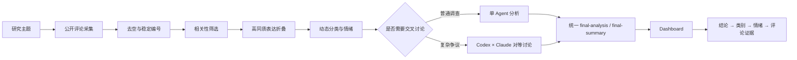

# Game Ops Insight Lab

> 从公开玩家评论中提取可验证问题，并把运营判断逐层回溯到真实证据。

Game Ops Insight Lab 是一套 Windows 优先的游戏运营事件研究工作台。它将 [MediaCrawler](https://github.com/NanmiCoder/MediaCrawler) 的公开评论采集能力，与本项目的评论清洗、语义折叠、玩家情感分析、单/双 Agent 复核和可交互 Dashboard 串成一条完整证据链。

本项目不是简单的“评论情绪总结器”：它保留样本边界、同质表达量、反向意见和原始评论编号，不把有限社媒样本包装成全体玩家民调，也不根据评论推断真实流水、留存或退游规模。

## 项目展示

| Dashboard 总览 | Codex × Claude 双 Agent CMD |
| --- | --- |
| 
 | 
 |

## 30 秒案例：Fate 二次联动

[查看完整脱敏案例](examples/hsr-fate-second-collab/README.md)

- 881 条基础清理评论进入相关性判断；
- 650 条相关评论，经高同质折叠形成 615 条代表记录；
- 按 `support_count` 最终计入 648 条玩家表达；
- 最大议题是剧情与演出，共 240 条；
- 直接评价整体联动的样本中，正向 41.86%、负向 40.70%。

**核心判断：**联动的传播力和角色吸引力较强，但剧情演出、设定融合与部分视觉交付没有完全兑现长期预热形成的期待；当前表现为中等运营风险，而不是已经证实的信任危机或商业损失。

## 完整工作流



采集层使用固定版本的 MediaCrawler 子模块；清洗后的所有分析与展示逻辑由本仓库实现。普通调查默认单 Agent，只有用户明确要求复核时才启动双 Agent，避免为了形式消耗第二个模型。

## 关键设计

### 1. 相关性优先保留有效短句

“建模不错”“剧情太少”“抽歪了”等短评论，只要对象明确并能贡献态度、体验或行为信号，就不会因为无法独立组成长观点而被误删。

### 2. 折叠同质表达，但不抹掉数量

只有对象、方面、立场、判断和理由均高度一致时才折叠。代表评论保留真实原文，并通过 `support_count` 表示它代表了多少条相似表达。

### 3. 结论可以回到评论证据

Dashboard 支持从总体判断进入玩家讨论类别，再按正向、负向、中性或混合查看代表记录；界面同时区分“加权表达数”和“折叠后的代表记录数”。

### 4. 单/双 Agent 使用同一结果协议

两种分析方式最终都生成：

```text
final-analysis.md
final-summary.json
```

Dashboard 因此不关心报告来自单 Agent 还是双 Agent。双 Agent 的初审、议题与对话只作为后台审议过程保留。

## 项目结构

```text
.agents/skills/game-ops-insight-suite/  一体化 Codex Skill
adapter/                               三平台 FastAPI 适配层
comment-cleaning/                      相关性与折叠协议
dual-agent/                            Codex × Claude 主持程序
examples/                              脱敏精选案例
insight-dashboard/                     FastAPI + React Dashboard
scripts/                               确定性处理与启动脚本
schemas/                               采集任务 Schema
source/                                MediaCrawler 固定版本子模块
```

## 快速开始（Windows）

需要 Python 3.11、Node.js 20.19+、Git for Windows 和 Chrome。双 Agent 模式还需要已安装并登录的 Codex CLI 与 Claude CLI。

```powershell
git clone --recurse-submodules https://github.com/x736260980-ui/game-ops-insight-lab.git
cd game-ops-insight-lab
powershell -ExecutionPolicy Bypass -File .\setup.ps1
```

查看公开案例：

```powershell
Copy-Item -Recurse .\examples\hsr-fate-second-collab .\runs\hsr-fate-second-collab
.\insight-dashboard\start-dashboard.cmd
```

启动三平台采集服务：

```powershell
.\scripts\run_douyin_api.ps1
.\scripts\run_bilibili_api.ps1
.\scripts\run_xiaohongshu_api.ps1
```

按需启动双 Agent：

```powershell
.\dual-agent\start_dual_agent.cmd
```

在 Codex 中也可以直接调用仓库 Skill：

```text
使用 $game-ops-insight-suite，研究指定游戏运营事件。默认先走单 Agent；只有我明确确认时才启动双 Agent。
```

## 稳定输出协议

每次调查使用独立目录：

```text
<run>/
├─ analysis-input.json
├─ semantic-analysis.json
├─ classification-plan.json
├─ dashboard.json
├─ final-analysis.md
├─ final-summary.json
└─ dual-agent/                 仅双 Agent 调查存在
   ├─ 01-codex-initial.md
   ├─ 02-claude-initial.md
   ├─ 03-transcript.md
   └─ 04-disputes.json
```

`final-summary.json` 使用 `game-ops-final-summary-1.0`：风险为 `0—1` 分数并映射为 `low / middle / high`，置信度单独描述证据强弱。

## 研究边界

- 公开评论是带有平台和采样偏差的玩家信号，不代表全体玩家；
- 分类为非互斥统计，类别比例不能相加成总体比例；
- 玩家关于官方动机、销量、退游或付费变化的说法默认属于待核实内容；
- 网页资料只用于背景、定性佐证和反向信号，不进入评论数量与情绪统计；
- Dashboard 展示研究结果，Agent 的完整对话不进入业务页面主体。

## 开源与第三方许可

本仓库原创代码使用 [MIT License](LICENSE)。

评论采集部分通过 Git 子模块使用 [NanmiCoder/MediaCrawler](https://github.com/NanmiCoder/MediaCrawler)，固定兼容提交为 `d6f7c5bb906b6dac40ddf343ef9e26438a3de092`。MediaCrawler 使用 `NON-COMMERCIAL LEARNING LICENSE 1.1`，仅限非商业学习与研究，其许可证不受本项目 MIT License 覆盖。详见 [第三方组件说明](THIRD_PARTY_NOTICES.md)。

## 项目演进

早期版本基于 Dify 工作流，侧重多 Agent 编排与长期记忆；当前版本转向本地可复现、证据有边界、结果可回溯的研究工作台。历史版本保留在 [Dify--trend-crawler](https://github.com/x736260980-ui/Dify--trend-crawler)。
