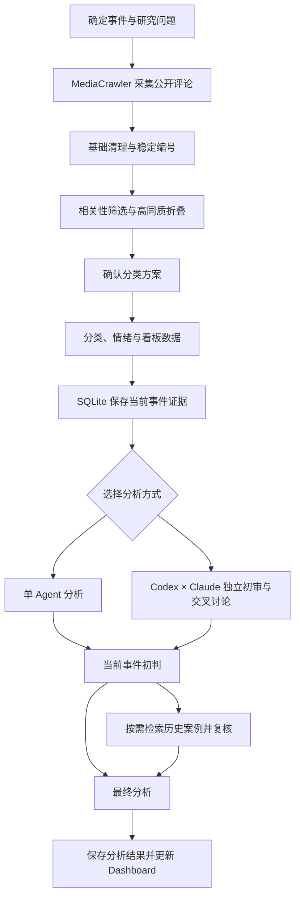

# Game Ops Insight Lab

面向游戏运营的玩家评论研究工作台。围绕一个具体事件，采集公开评论、整理讨论焦点与情绪，再把分析结果放进可交互看板，逐层查看结论背后的原始表达。

采集层基于 [MediaCrawler](https://github.com/NanmiCoder/MediaCrawler)，支持抖音、Bilibili 和小红书。本项目在此基础上实现评论处理、单／双 Agent 分析、历史案例检索与 Dashboard。

## 项目展示

| Dashboard 总览 | Codex × Claude 讨论 |
|:---:|:---:|
|  |  |

## 从评论到运营判断

一次联动可能同时出现“喜欢角色”“不满意剧情”“还会抽卡”三种表达。只统计正负面，很容易把不同问题混在一起。

这个工作台先整理玩家具体在评价什么，再分析态度、理由与分歧。最终可以在看板中查看主要议题、代表评论和运营分析，也能从结论返回评论，核对判断是否站得住。

- **清洗与折叠**：筛掉无关内容，保留有意义的短评；高度同质的表达合并为代表记录，同时保留 `support_count` 表达数量。
- **按事件分类**：围绕当前事件生成类别，确认类别边界后再做全量分类和情绪判断。一条评论可以涉及多个方面。
- **分析与复核**：常规事件使用单 Agent；复杂争议可选择 Codex × Claude，先各自分析，再围绕分歧交叉讨论。
- **回查与复用**：Dashboard 串联结论、类别、情绪和评论；SQLite 保存历史证据，支持关键词检索与历史对照。

## 工作流程

每个事件都有独立的运行记录，保存各阶段状态和文件位置，可以从未完成的环节继续。历史对照在当前事件初判之后进行，避免一开始就照搬旧案例的结论。

## 几个关键取舍

**减少重复，但留下分歧。** 折叠只合并对象、方面、立场和理由高度一致的表达。看板分别保留代表记录数与折叠前的表达数量；`support_count` 是表达数量，不是独立玩家人数。

**分类方案需要确认，逐条执行交给模型。** 相关性判断直接分为保留与排除；分类表先确认名称、定义和边界，再批量处理评论。

**双 Agent 用于处理分歧。** 第二个 Agent 先独立形成判断，再讨论证据与解释上的差别。两条分析路径最终使用相同的报告格式，方便在看板中查看。

**分析结果可以回查。** 保留评论原文、稳定编号、类别与情绪映射。官方动机、收入和留存等无法从评论直接验证的内容，不作为已确认结论。

## 案例与使用

- [查看完整案例](examples/hsr-fate-second-collab/README.md)：评论输入、分类结果、看板数据与最终分析。
- [使用说明](docs/USAGE.md)：安装、启动、采集、分析与 SQLite 使用。
- [Bilibili 视频与图文采集](docs/BILIBILI-VIDEO-DYNAMIC-WORKFLOW.md)。

## 项目组成

| 目录 | 内容 |
| --- | --- |
| `source/`、`adapter/` | MediaCrawler 子模块与三平台采集适配 |
| `comment-cleaning/`、`scripts/` | 评论处理规则与处理脚本 |
| `.agents/skills/` | 各阶段任务说明与流程编排 |
| `dual-agent/` | Codex × Claude 讨论程序 |
| `storage/` | SQLite、全文检索与历史复核 |
| `insight-dashboard/` | FastAPI + React 看板 |
| `examples/` | 公开案例及分析结果 |

另有可选的 [Player Persona 蒸馏实验](docs/PLAYER-PERSONA-DISTILLATION.md)，参考 [Distilly](https://github.com/titanwings/distilly) 将筛选后的评论材料提炼为虚拟玩家 Skill，目前作为独立实验保留。

## 使用范围与许可

项目面向公开评论的学习与研究。样本存在平台和采样偏差，分类也允许多选，因此情绪与类别统计应结合各自口径阅读。

本仓库原创代码采用 [MIT License](LICENSE)。采集部分使用 [MediaCrawler](https://github.com/NanmiCoder/MediaCrawler)，其 `NON-COMMERCIAL LEARNING LICENSE 1.1` 仅限非商业学习与研究，不受本项目 MIT 许可覆盖。详见 [第三方组件说明](THIRD_PARTY_NOTICES.md)。
